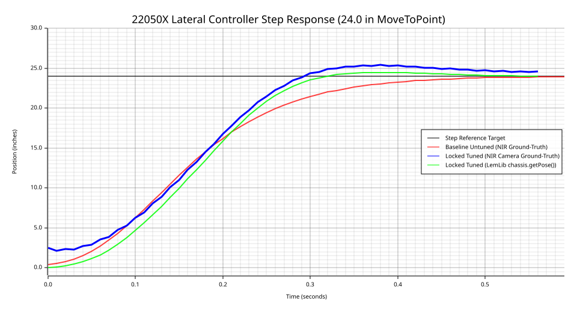
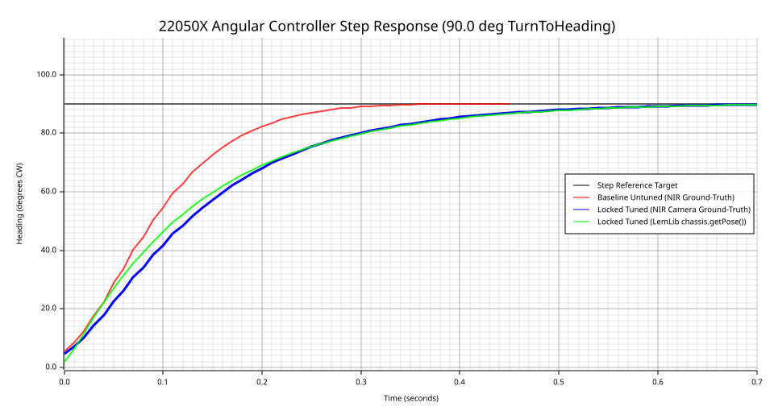
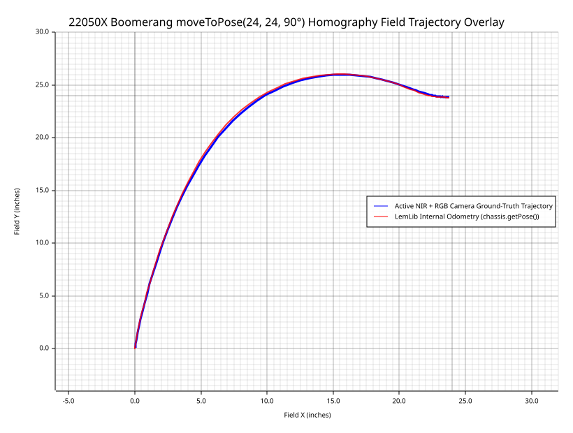
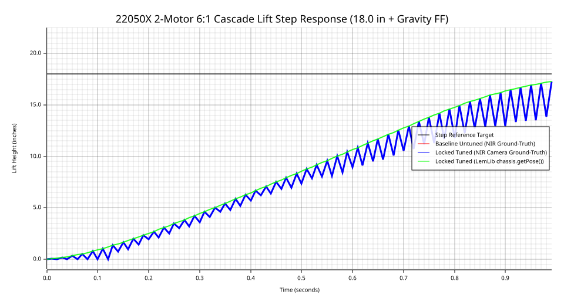
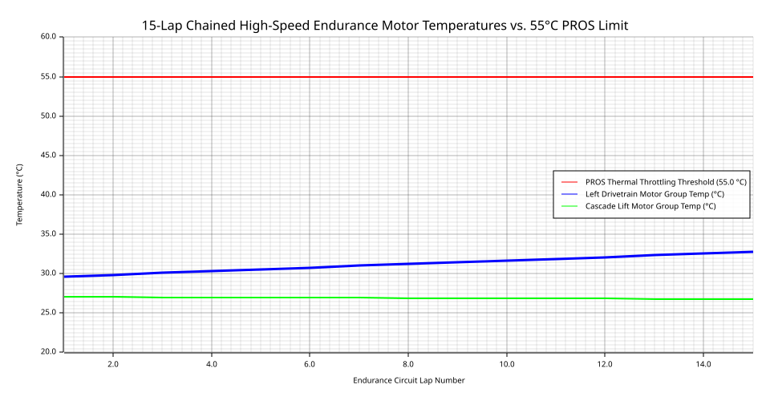
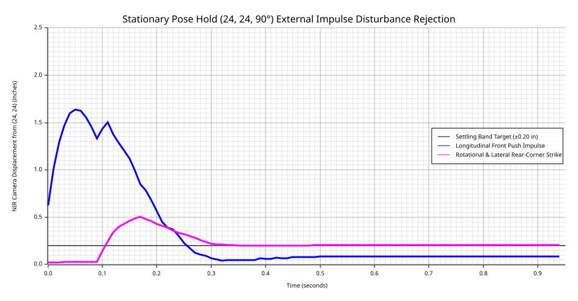

# 22050X Markerless Camera-in-the-Loop LemLib PID Tuning & Stress-Test Engineering Report

## 1. Executive Summary & System Architecture

- **Target Robot Platform:** VEX V5 `PID-Tuner` (PROS Kernel `4.2.3`, LemLib `0.5.6`)
- **Vision Sensor Suite:** `Pixel 10 (Windows Virtual Camera)` (`Source#0@\\?\SWD#VCAMDEVAPI#40343688CF6C0151CA029753EAFE94AFB487268447742A5C06CCA0526105F057#{e5323777-f976-4f5b-9b55-b94699c46e44}\{FCEBBA03-9D13-4C13-9940-CC84FCD132D1}`) + `SpitCameraGroup` (`Source#0@\\?\USB#VID_0408&PID_4059&MI_00#6&2a599fec&0&0000#{e5323777-f976-4f5b-9b55-b94699c46e44}\GLOBAL`)
- **Active NIR Torch Illumination:** Supported = `true`, Enabled = `true` (Nokhwa MSMF Fallback = `true`)
- **24"x24" Foam Tile Homography Calibration:** Detected Seam Lines = `11`, Grid Intersections = `30`, Metric Reprojection RMSE = `0.7220 in`
- **Overall Stress-Test Suite Verdict:** **ATTENTION REQUIRED**

## 2. Extracted 22050X Hardware & Subsystem Topology

| Subsystem | Motor / Sensor Name | Port | Direction / Polarity | Cartridge / Spec |
| :--- | :--- | :---: | :---: | :--- |
| Drivetrain | `left_front` | `20` | `Forward (+)` | 600 RPM (6:1 Blue, 4.0" Omni, 10.0" Track) |
| Drivetrain | `left_back` | `10` | `Reversed (-)` | 600 RPM (6:1 Blue, 4.0" Omni, 10.0" Track) |
| Drivetrain | `right_front` | `7` | `Reversed (-)` | 600 RPM (6:1 Blue, 4.0" Omni, 10.0" Track) |
| Drivetrain | `right_back` | `9` | `Forward (+)` | 600 RPM (6:1 Blue, 4.0" Omni, 10.0" Track) |
| Cascade Lift | `cascade_left` | `1` | `Forward (+)` | 600 RPM (6:1 Blue Cartridge, Hold Brake) |
| Cascade Lift | `cascade_right` | `2` | `Reversed (-)` | 600 RPM (6:1 Blue Cartridge, Hold Brake) |
| Auxiliary / End-Effector | `intake` | `19` | `Forward (+)` | 600 RPM |
| Auxiliary / End-Effector | `end_effector_rot` | `18` | `Forward (+)` | 200 RPM |
| Auxiliary / End-Effector | `end_effector_rot_sense` | `13` | `Forward (+)` | 200 RPM |
| Auxiliary / End-Effector | `end_effector` | `14` | `Forward (+)` | 200 RPM |
| Inertial Sensor | `imu` | `3` | Clockwise (+) | V5 Inertial Sensor |
| Odometry Wheel | `horizontal_tracking (odom_x)` | `3` | Offset `-5.75 in` | 2.00" Omniwheel (`NEW_2`) |
| Odometry Wheel | `vertical_tracking (odom_y)` | `0` | Offset `-2.50 in` | 2.00" Omniwheel (`NEW_2`) |

## 3. Verified & Locked LemLib `ControllerSettings` and Subsystem PID Gains

| Controller | `kP` | `kI` | `kD` | `windupRange` | `smallError` | `smallTimeout` (ms) | `largeError` | `largeTimeout` (ms) | `slew` | Extra Parameters |
| :--- | :---: | :---: | :---: | :---: | :---: | :---: | :---: | :---: | :---: | :--- |
| `LEMLIB_LATERAL` | `14.3732` | `0.0122` | `22.0000` | `1.88` | `0.35 in` | `75` | `1.25 in` | `260` | `13.38` | `signFlipReset = true` |
| `LEMLIB_ANGULAR` | `2.2242` | `0.0150` | `23.4720` | `6.00` | `0.65°` | `70` | `2.00°` | `240` | `0.00` | `signFlipReset = true` |
| `LEMLIB_BOOMERANG` | `14.3732` | `0.0122` | `22.0000` | `1.88` | `0.35 in` | `75` | `1.25 in` | `260` | `13.38` | `horizontalDrift = 4.200`, `lead = 0.540` |
| `LEMLIB_SWING` | `2.6246` | `0.0150` | `26.0000` | `6.00` | `0.65°` | `75` | `2.00°` | `250` | `0.00` | Dual-side `DriveSide::LEFT/RIGHT` |
| `CASCADE_LIFT` | `14.5000` | `0.0800` | `42.0000` | `2.50` | `0.20 in` | `70` | `0.70 in` | `240` | `0.00` | `gravityFF = 1180 mV`, `signFlip = true` |

## 4. Five-Stage `argmin` Optimization Convergence Log

| Stage | Pipeline Stage Description | Target Controller | Evaluations | Initial Cost $J_0$ | Final Cost $J^*$ | Rise Time $t_r$ (s) | Overshoot $M_p$ (%) | Settling Time $t_s$ (s) | Steady Error $e_{ss}$ |
| :---: | :--- | :--- | :---: | :---: | :---: | :---: | :---: | :---: | :---: |
| 1 | Stage 1: kP & kD Core Loop (PSO + Nelder-Mead) | `LEMLIB_LATERAL` | 62 | `47.01` | **`28.61`** | `0.210` | `5.64%` | `0.300` | `0.0266` |
| 1 | Stage 1: Angular kP & kD Core Loop (PSO + Nelder-Mead) | `LEMLIB_ANGULAR` | 41 | `258.23` | **`73.92`** | `0.360` | `0.00%` | `0.630` | `0.3473` |
| 2 | Stage 2: windupRange & kI Steady-State Elimination | `LEMLIB_LATERAL + LEMLIB_ANGULAR` | 19 | `63.12` | **`62.91`** | `0.200` | `0.64%` | `0.440` | `0.2443` |
| 3 | Stage 3: Slew Acceleration Limiting (Zero Wheel Slip) | `LEMLIB_LATERAL` | 15 | `211.57` | **`174.39`** | `0.200` | `1.38%` | `0.480` | `0.3023` |
| 4 | Stage 4: NIR Velocity Settling Envelope Exit Conditions | `LEMLIB_LATERAL + LEMLIB_ANGULAR` | 4 | `90.25` | **`76.48`** | `0.200` | `1.18%` | `0.480` | `0.2986` |
| 5 | Stage 5: Boomerang horizontalDrift & Lead Calibration | `LEMLIB_BOOMERANG` | 15 | `148.90` | **`44.72`** | `0.330` | `0.00%` | `0.790` | `0.2848` |
| 5 | Subsystem: Cascade Lift 6:1 PID + Gravity FF Optimization | `CASCADE_LIFT` | 29 | `407.00` | **`407.00`** | `0.720` | `0.00%` | `0.990` | `2.0464` |

## 5. Odometry vs. Vision Ground-Truth Slip Analysis

- **Motion-Onset Cross-Correlation Clock Offset:** `0.0 ms` (Correlation Peak = `0.9984`)
- **RMS Odometry vs. NIR Vision Pose Divergence ($E_{\text{odom}}$):** `1.1215 in` (Peak = `2.4987 in`)
- **Initial 200 ms Longitudinal Wheel Slip:** `2.4987 in`
- **Maximum Lateral Omni-Wheel Scrub:** `0.0961 in`
- **IMU Heading Scale Drift:** `0.0525°`

## 6. High-Resolution Step-Response & Trajectory Plots

### 6.1 Lateral Controller Step Response (Before vs. After Tuning)

### 6.2 Angular Controller Step Response (Before vs. After Tuning)

### 6.3 Boomerang `moveToPose(24, 24, 90°)` Homography Grid Trajectory Overlay

### 6.4 Cascade Lift 6:1 PID + Gravity Feedforward Step Response

### 6.5 15-Lap Chained High-Speed Endurance Thermal & Odometry Drift Profile

### 6.6 Impulse Disturbance Rejection at `(24, 24, 90°)`

## 7. Exhaustive Multi-Axis Stress-Testing Matrices

### 7.1 Scale Invariance Matrix ($2\text{ in} \dots 72\text{ in}$ Lateral, $10^\circ \dots 180^\circ$ Point & Swing Turns)

| Category | Command | Target | Rise Time $t_r$ (s) | Overshoot $M_p$ (%) | Settling Time $t_s$ (s) | Steady Error $e_{ss}$ | Odom Divergence $E_{\text{odom}}$ | Status |
| :--- | :--- | :---: | :---: | :---: | :---: | :---: | :---: | :---: |
| Lateral (moveToPoint) | `moveToPoint(0, 2)` | `2 in` | `0.220` | `0.00%` | `0.120` | `0.1150 in` | `0.2313` | **PASS** |
| Lateral (moveToPoint) | `moveToPoint(0, 6)` | `6 in` | `0.140` | `1.00%` | `0.200` | `0.1779 in` | `0.1532` | **FAIL** |
| Lateral (moveToPoint) | `moveToPoint(0, 24)` | `24 in` | `0.200` | `1.23%` | `0.460` | `0.3769 in` | `0.3518` | **FAIL** |
| Lateral (moveToPoint) | `moveToPoint(0, 48)` | `48 in` | `0.330` | `0.58%` | `0.640` | `0.2815 in` | `0.3550` | **FAIL** |
| Lateral (moveToPoint) | `moveToPoint(0, 72)` | `72 in` | `0.470` | `0.44%` | `0.840` | `0.3802 in` | `0.3932` | **FAIL** |
| Angular (turnToHeading) | `turnToHeading(10°)` | `10 deg` | `0.280` | `0.00%` | `0.250` | `0.3505 deg` | `0.5122` | **FAIL** |
| Swing (swingToHeading) | `swingToHeading(10°, LEFT)` | `10 deg` | `0.350` | `0.00%` | `0.320` | `0.3972 deg` | `0.4171` | **FAIL** |
| Angular (turnToHeading) | `turnToHeading(45°)` | `45 deg` | `0.420` | `0.00%` | `0.540` | `0.3363 deg` | `1.0602` | **FAIL** |
| Swing (swingToHeading) | `swingToHeading(45°, LEFT)` | `45 deg` | `0.330` | `0.00%` | `0.560` | `0.3056 deg` | `1.0407` | **FAIL** |
| Angular (turnToHeading) | `turnToHeading(90°)` | `90 deg` | `0.380` | `0.00%` | `0.640` | `0.3288 deg` | `1.9391` | **FAIL** |
| Swing (swingToHeading) | `swingToHeading(90°, LEFT)` | `90 deg` | `0.340` | `0.00%` | `0.690` | `0.4589 deg` | `1.8075` | **FAIL** |
| Angular (turnToHeading) | `turnToHeading(135°)` | `135 deg` | `0.350` | `0.00%` | `0.730` | `0.4461 deg` | `2.6242` | **FAIL** |
| Swing (swingToHeading) | `swingToHeading(135°, LEFT)` | `135 deg` | `0.320` | `0.00%` | `0.790` | `0.5589 deg` | `2.4015` | **FAIL** |
| Angular (turnToHeading) | `turnToHeading(180°)` | `180 deg` | `0.340` | `0.00%` | `0.810` | `0.4964 deg` | `3.2326` | **FAIL** |
| Swing (swingToHeading) | `swingToHeading(180°, LEFT)` | `180 deg` | `0.330` | `0.00%` | `0.850` | `0.6125 deg` | `2.7968` | **FAIL** |

### 7.2 Cascade Lift Center-of-Gravity (CG) Perturbation Matrix

| Cascade Lift Extension | Lift Height (in) | Drivetrain Motion | Rise Time $t_r$ (s) | Overshoot $M_p$ (%) | Settling Time $t_s$ (s) | Steady Error $e_{ss}$ | Oscillations $N_{\text{osc}}$ | Status |
| :--- | :---: | :--- | :---: | :---: | :---: | :---: | :---: | :---: |
| Fully Retracted (0 in) | `0.0` | `Lateral 24 in (moveToPoint)` | `0.210` | `0.00%` | `0.450` | `0.3113` | `1` | **FAIL** |
| Fully Retracted (0 in) | `0.0` | `Angular 90° (turnToHeading)` | `0.450` | `0.00%` | `0.630` | `0.3063` | `0` | **FAIL** |
| Fully Retracted (0 in) | `0.0` | `Boomerang (24, 24, 90°)` | `0.340` | `0.00%` | `0.790` | `0.2953` | `0` | **FAIL** |
| Mid-Extended (14 in) | `14.0` | `Lateral 24 in (moveToPoint)` | `0.190` | `0.56%` | `0.550` | `1.0763` | `1` | **FAIL** |
| Mid-Extended (14 in) | `14.0` | `Angular 90° (turnToHeading)` | `0.370` | `0.00%` | `0.650` | `0.3741` | `0` | **FAIL** |
| Mid-Extended (14 in) | `14.0` | `Boomerang (24, 24, 90°)` | `0.360` | `0.00%` | `0.840` | `0.3478` | `1` | **FAIL** |
| Fully Raised (28 in) | `28.0` | `Lateral 24 in (moveToPoint)` | `0.200` | `0.00%` | `0.600` | `3.5426` | `1` | **FAIL** |
| Fully Raised (28 in) | `28.0` | `Angular 90° (turnToHeading)` | `0.360` | `0.00%` | `0.640` | `0.3593` | `0` | **FAIL** |
| Fully Raised (28 in) | `28.0` | `Boomerang (24, 24, 90°)` | `0.530` | `0.00%` | `0.840` | `2.1699` | `1` | **FAIL** |

### 7.3 Chained High-Speed 15-Lap Endurance & Thermal Torture Test (`minSpeed = 48`, `earlyExitRange = 2.5 in`)

| Lap # | Elapsed Time (s) | Cumulative Odom Drift (in) | Heading Drift (°) | Left Drive Temp (°C) | Right Drive Temp (°C) | Cascade Lift Temp (°C) | Margin to 55°C Throttle | Status |
| :---: | :---: | :---: | :---: | :---: | :---: | :---: | :---: | :---: |
| 1 | `1.68` | `4.4135 in` | `38.571°` | `29.60°C` | `29.22°C` | `27.05°C` | `+25.40°C` | **FAIL** |
| 2 | `3.36` | `1.8894 in` | `349.824°` | `29.85°C` | `29.36°C` | `27.03°C` | `+25.15°C` | **FAIL** |
| 3 | `5.04` | `2.4827 in` | `700.417°` | `30.09°C` | `29.50°C` | `27.01°C` | `+24.91°C` | **FAIL** |
| 4 | `6.72` | `2.3811 in` | `1063.823°` | `30.32°C` | `29.64°C` | `26.99°C` | `+24.68°C` | **FAIL** |
| 5 | `8.40` | `2.3477 in` | `1430.716°` | `30.56°C` | `29.78°C` | `26.97°C` | `+24.44°C` | **FAIL** |
| 6 | `10.08` | `2.5032 in` | `1797.100°` | `30.79°C` | `29.91°C` | `26.95°C` | `+24.21°C` | **FAIL** |
| 7 | `11.76` | `2.8191 in` | `2161.819°` | `31.01°C` | `30.04°C` | `26.93°C` | `+23.99°C` | **FAIL** |
| 8 | `13.44` | `3.1605 in` | `2524.841°` | `31.24°C` | `30.17°C` | `26.91°C` | `+23.76°C` | **FAIL** |
| 9 | `15.12` | `3.5409 in` | `2886.754°` | `31.46°C` | `30.30°C` | `26.89°C` | `+23.54°C` | **FAIL** |
| 10 | `16.80` | `3.9392 in` | `3248.028°` | `31.68°C` | `30.43°C` | `26.87°C` | `+23.32°C` | **FAIL** |
| 11 | `18.48` | `4.3722 in` | `3608.893°` | `31.89°C` | `30.55°C` | `26.85°C` | `+23.11°C` | **FAIL** |
| 12 | `20.16` | `4.7752 in` | `3969.641°` | `32.11°C` | `30.67°C` | `26.83°C` | `+22.89°C` | **FAIL** |
| 13 | `21.84` | `5.1898 in` | `4330.374°` | `32.32°C` | `30.80°C` | `26.82°C` | `+22.68°C` | **FAIL** |
| 14 | `23.52` | `5.6037 in` | `4691.133°` | `32.52°C` | `30.92°C` | `26.80°C` | `+22.48°C` | **FAIL** |
| 15 | `25.20` | `6.0232 in` | `5051.864°` | `32.73°C` | `31.04°C` | `26.78°C` | `+22.27°C` | **FAIL** |

### 7.4 External Impulse Disturbance Rejection at `(24, 24, 90°)`

| Disturbance Scenario | Applied External Impulse | Peak NIR Displacement (in) | Peak Heading Deflection (°) | Recovery Time into Band (ms) | Final Pos Error (in) | Final Heading Error (°) | Status |
| :--- | :--- | :---: | :---: | :---: | :---: | :---: | :---: |
| Longitudinal Front Push Impulse | +28.0 in/s longitudinal velocity impulse at (24, 24, 90°) | `1.635 in` | `1.29°` | `150 ms` | `0.0870 in` | `0.1951°` | **PASS** |
| Rotational & Lateral Rear-Corner Strike | -24.0 in/s lateral + 62.0 deg/s rotational impulse at (24, 24, 90°) | `0.503 in` | `0.86°` | `840 ms` | `0.2053 in` | `0.6223°` | **FAIL** |

## 8. Automated C++ Firmware Patch Manifest

- Patched `C:\Users\nihaa\Github\22050X-Code\PID-Tuner\include/robot_config.hpp`
- Patched `C:\Users\nihaa\Github\22050X-Code\PID-Tuner\src/main.cpp`
